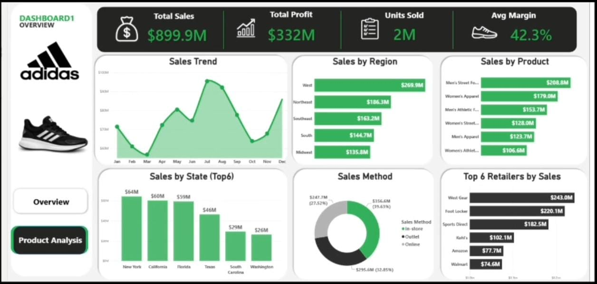
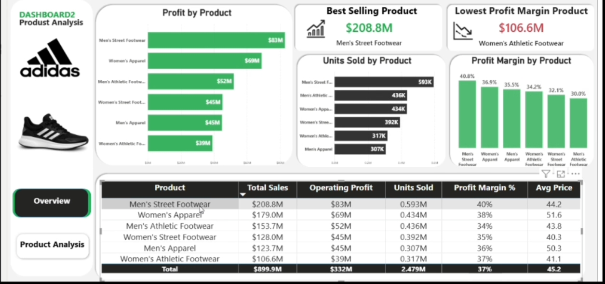

# Adidas Sales Dashboard

**US Sales Performance and Product Profitability Analysis**

An interactive Power BI dashboard analyzing Adidas US sales: revenue, operating profit, units sold, margins, retailers, regions, states and sales channels, with a custom sidebar navigation and a black/green design styled after the Adidas brand.

## Project Question

How is Adidas performing across regions, products, retailers and sales channels, and which products drive the profit versus which ones lag on margin?

## Dashboard Pages

| Page | What it answers |
|---|---|
| **Overview** | KPI cards (total sales, profit, units, average margin), monthly sales trend, sales by region, product, state (top 6), sales method mix, and top 6 retailers |
| **Product Analysis** | Profit by product, best selling and lowest margin product cards, units sold and profit margin by product, and a full product comparison table |
| **Why** | Decomposition tree breaking total sales down by region, sales method and retailer for root-cause analysis |
| **Sales Target (tooltip page)** | Gauge showing total sales against a target, used as a hover tooltip |

## Key Metrics (as shown in the report)

- **Total Sales:** $899.9M
- **Operating Profit:** $332M
- **Units Sold:** 2M
- **Overall Profit Margin:** 37% (weighted)
- **Avg Margin:** 42.3%
- **Avg Price:** $45.2

## Key Insights

- West is by far the strongest region at $269.9M in sales, nearly double the Midwest ($135.8M).
- Outlet is the largest sales channel: $356.6M (39.6%) of sales, ahead of Online ($295.6M, 32.9%) and In-store ($247.7M, 27.5%).
- Men's Street Footwear leads on every measure: highest sales ($208.8M), highest profit ($83M) and highest margin (40.8%).
- Women's Athletic Footwear is the weakest seller ($106.6M), and Men's Athletic Footwear has the lowest margin (30.0%) despite mid-table sales, pointing at a pricing or cost issue.
- New York is the top state ($64M), ahead of California ($60M) and Florida ($59M).
- West Gear is the top retailer ($243.0M), followed by Foot Locker ($220.1M) and Sports Direct ($182.5M).
- Sales climb through the first months and peak in July, with March and November the softest months.

## Data Model

- **Fact table:** `Data Sales Adidas` (sales records: retailer, region, state, product, sales method, units sold, total sales, operating profit)
- **Dimension:** `Calendar` (dates and months for the trend analysis)
- **Measures (DAX),** including:
 - Volume: Total Sales, Operating Profit, Units Sold
 - Margin: Profit Margin % (weighted), Avg Margin, Avg Price
 - Target: Sales Target measure used by the tooltip gauge
 - Product ranking: measures behind the Best Selling / Lowest Margin product cards
- **Extras:** decomposition tree (Analyze: Total Sales; Explain by: Region, Sales Method, Retailer), tooltip gauge page, custom Adidas-styled sidebar navigation, black/green theme

## Data Preparation and Challenges

- **Margin done right:** an overall margin cannot be a simple average of product margins, because products sell in different volumes. Profit Margin % is therefore calculated as a weighted margin (total operating profit divided by total sales), which keeps the table's total row consistent with the cards.
- **Dynamic best/worst product cards:** the "Best Selling Product" and "Lowest Profit Margin Product" cards are not hard-coded. They use ranking measures (TOPN-style logic) so the right product name and value show even when the report is filtered.
- **Answering "why", not only "what":** a decomposition tree page lets the user break total sales down step by step (region, then sales method, then retailer) to find what is driving a number, instead of adding more static charts.
- **Readable channel mix:** the sales-method donut shows both the value and the share of total in its labels, so the channel split reads at a glance without a legend lookup.
- **Focusing on what matters:** with 50 states and many retailers, the state and retailer views use Top N filtering (top 6) so the charts stay readable instead of listing everything.
- **Cleaning in Power Query:** set correct data types for currency and margin columns, parsed invoice dates into a proper Calendar table for the monthly trend, and standardized retailer and product naming before modeling.

## Known Limitations

- **Two margin numbers:** the Overview card shows Avg Margin 42.3% (a simple average), while the product table totals to a 37% weighted margin. The card is kept as the report shows it; the weighted figure is the accurate overall margin.
- **Card label mismatch:** the "Lowest Profit Margin Product" card displays a sales value ($106.6M for Women's Athletic Footwear); the lowest profit margin product in the chart is Men's Athletic Footwear at 30.0%. Kept as-is in this version.
- **Title typos:** the Product Analysis page header reads "Produst Analysis", and the sidebar labels read "DASHBOARD1" / "DASHBOARD2". Kept as-is in this version.
- **Branding:** the report is styled with the Adidas brand (logo and colors) for presentation; it is a portfolio project, not an official Adidas product or analysis.

## Tools

- Power BI Desktop (data modeling, report design)
- DAX
- Power Query

## Screenshots

### Overview

### Product Analysis

## Files

This repository contains a project overview and dashboard screenshots only. The Power BI report file and underlying data are not distributed.

- `screenshots/` - dashboard page screenshots

## Author

**Zeyad Ashraf** - Data Analyst
[LinkedIn](https://www.linkedin.com/in/zeyad-ashraf-065794371) | [GitHub](https://github.com/Zeyada0) | [Portfolio](https://zeyada0.github.io/portfolio/)
